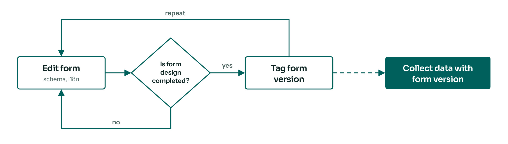

.. _forms:

Forms
=====

The forms are the heart of Amber. A form describes how the data will be collected, with a built-in support for multilanguage. A form's **schema** exists in two formats:

* The **JSON Forms** format, rendered by the new :ref:`form_engine`: a JSON Schema describing the data, a UI schema describing the layout of the controls, and the translations. A new form is created in this format and is edited with a visual form builder.
* The **legacy** format, made of **Items** (data input fields, structural items such as group and section, or computed fields) and **Translations** (a list of translation keys with values for each language). The forms in this format can still be edited and used, and can be converted to the new format (see :ref:`form_conversion`).

The data collected have the same shape in both formats.

Different versions of a form can be saved, which allows to safely edit a form while a version is used for data capture. Form versions also ensure that the data collected are properly described by the form that was used to collected them, avoiding variable renaming errors, options addition/removal conflicts, changes in the labels which could affect the question semantic etc.

List of forms
-------------

From the list of forms the following operations are available:

Add a form
~~~~~~~~~~

When creating a form, a name is required, a description is optional. This is purely informative for management purpose and will not appear when the form is administered.

It is possible to pre-populate the form with a schema that was previously exported from another form, in either format. This is optional and can also be done later.

Delete form(s)
~~~~~~~~~~~~~~

To delete several forms:

* Select one or more forms in the list,
* Press the Delete selected forms button and confirm.

You can also delete a specific form by pressing the form's Delete action button.

.. note::
  The removal of a form will fail when there are associated case reports. Make sure to extract the recorded data (if necessary) before removing them.

Single form
------------

To navigate to a form page, click on the form's name or the pencil icon. The page that is opened has two tabs:

* The schema tab, with the form builder: the form settings and the :ref:`form builder <form_engine>` for a form in the JSON Forms format; the form items builder and the translations editor for a form in the legacy format,
* The list of the form's versions.

Export
~~~~~~

Export the form's schema in text file (JSON format). Advanced users can edit this file, which can be convenient for the translations section for instance. A form in the JSON Forms format is exported with its form-level settings, its ``schema``, its ``uischema`` and its ``translations``.

Import
~~~~~~

Import a previously exported form schema, in either format. This operation will replace the whole form schema (items and translations, or schema, UI schema and translations).

Convert
~~~~~~~

Available for a form in the legacy format: converts the form to the new :ref:`form engine <form_engine>`, with a side by side preview of both forms. See :ref:`form_conversion`.

Tag
~~~

Creates a new form revision. Giving a comment that describes the changes in the form is recommended.

.. _forms_items:

Items (legacy format)
~~~~~~~~~~~~~~~~~~~~~

This section applies to the forms in the legacy format. For the forms in the JSON Forms format, see :ref:`form_engine`.

The form items is a tree which root is the form itself.

The following form item types are available:

========================== =============== ========================================
Type                       Category        Description
========================== =============== ========================================
:ref:`auto_complete`       Select          Select a single or multiple values by filtering a (long) list of options.
:ref:`dropdown`            Select          Select a single or multiple values in a menu.
:ref:`image_select`        Select          Select a single or multiple areas on an image.
:ref:`multiple_choices`    Select          Checkbox choices.
:ref:`single_choice`       Select          Radio choices.
:ref:`date`                Temporal        Date value, in ``yyyy-MM-dd`` format (ISO 8601).
:ref:`datetime`            Temporal        Date and time value, in ``yyyy-MM-dd mm:ss`` format (ISO 8601).
:ref:`time`                Temporal        Time value, in ``mm:ss`` format.
:ref:`geo_data`            Geographic      Select a single or multiple geographic features (point or polygon).
:ref:`number`              Number          Input field with numeric value.
:ref:`rating`              Number          Gradual numeric values, rendered as icons.
:ref:`slider`              Number          Gradual numeric values, rendered as a slider.
:ref:`paragraph`           Text            Long text.
:ref:`short_answer`        Text            Short text.
:ref:`group`               Structure       Group one or more items.
:ref:`section`             Structure       Information text.
:ref:`toggle`              Logical         True or False.
:ref:`computed`            Other           Not visible, data is computed with the other item's data.
========================== =============== ========================================

The following definition settings are common to all items:

================== ====================================
Setting            Description
================== ====================================
``Type``           The type of item (see above).
``Name``           The name of the item is not visible: it will be associated to the data collected.
``Label``          The label is usually a question or a title.
``Description``    The description gives some guidance about how to enter data, what are there meaning etc.
``Required``       Whether an input is mandatory (does not apply to structural items such as Group and Section).
================== ====================================

Some settings are expressed by a script which is evaluated at each data entry.

================== ====================================
Setting            Description
================== ====================================
``Condition``      The condition makes an item visible or not depending of other data. It is a small script which returns a logical value. True when item is visible.
``Validation``     True when item value is valid. Does not apply to items not capturing data (such as :ref:`group` or :ref:`section`).
================== ====================================

The scripting language is Javascript. It allows to express complex logic with a single line. See detailed explanations:

* :ref:`cb_condition`
* :ref:`cb_validation`

Translations (legacy format)
~~~~~~~~~~~~~~~~~~~~~~~~~~~~

The translations are a list of tuples:

* A translation key,
* Associated texts for each of the defined languages.

The translation key can be a real text (example: "What is your age?"), but to avoid confusion when the wording of the question changes it is recommended to use a short (yet meaningful enough) text (example: "age_label"). When a language has no translation for a given key, the fallback language is English (``en``). If no translation can be found for the fallback language, the translation key is returned.

Add translation
^^^^^^^^^^^^^^^

**Add a translation key**

A translation key can be added manually. First enter the key in the dialog, then once a new line has been added in the list of translations, click in each language cell to set the translated text. The list of translations will be saved automatically.

**Merge with items translations keys**

This operation automatically adds translation keys for each item setting representing a text to display (Label, Description, Hint, Close label etc.). If the translation key already exists, it is not modified, only new entries are added. See :ref:`cb_translation` for details.
