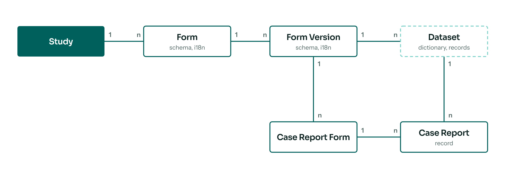

Content
=======

This section is where the studies are designed and from where the data records will be extracted. It is not accessible to ``Guest`` users, accessible read-only to ``Interviewer`` users, and editable by ``Manager`` and ``Administrator`` users.

The Amber data model is the following:

* A **Study** has **Forms**,
* A **Form** has a schema (the description of fields/items, with multilanguage support) and associated **Form versions**,
* A **Case Report Form** describes the context of a data collection with a **Form version**,
* A **Case Report** is a record of data that were captured using a **Case Report Form**,
* A **Study** has **Interview designs**,
* An **Interview design** has ordered **Steps**, each step being linked to a **Form version** (the latest one when no revision is specified),
* An **Interview design** has **Campaigns**, each campaign having **Participants**,
* An **Interview** is the record of a **Participant**, made of one **Interview step** record per step.

The case reports and the interviews are the two ways of collecting data with a form version: a case report is a single record captured by a user (see :doc:`crfs`), whereas an interview is a sequence of records captured by or with a participant (see :doc:`itws`).

An extraction of records (case reports or interview steps) constitutes a **Dataset**, i.e. a synthesis of a data dictionary (built from the Form schema, in a specific version) and the data (the records).

.. toctree::
   :maxdepth: 2

   studies
   forms
   form-engine
   items/index
   crfs
   itws
   records
